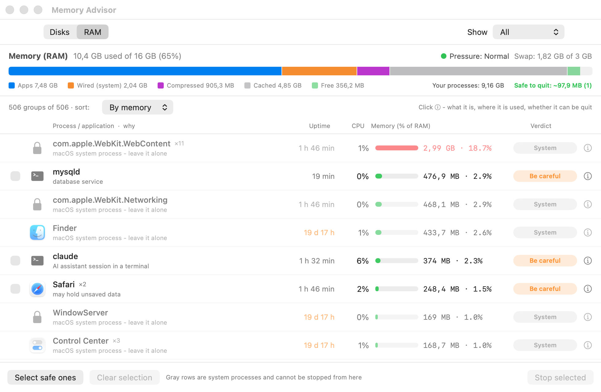
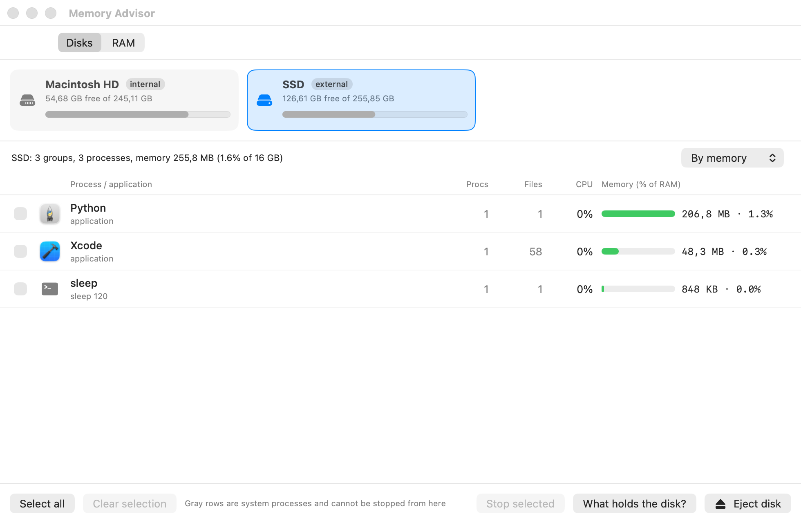

# Memory Advisor

**A native macOS app that shows what is using your RAM, tells you whether each process is safe to quit, and ejects external drives safely.**

Think of it as an Activity Monitor with opinions: for every process or app it shows how much memory it really uses, how long it has been running, and a verdict — *Safe to quit*, *Be careful* or *System* — with the reason. It also finds out **what is keeping an external drive busy** ("disk in use" / "disk not ejected properly") and stops those processes gracefully before ejecting.

   

**[⬇ Download the latest DMG](https://github.com/Yeskendirr/mac-memory-advisor/releases/latest)** · Free and open source · No network access, no telemetry · English and Russian



## What it does

**RAM tab — what is eating my memory, and can I close it?**
- Memory summary like Activity Monitor: apps, wired, compressed, cached, free, swap, memory pressure.
- Every process/app grouped (an app and all its helper processes appear as one row) with memory in MB and **% of your total RAM**, CPU, and **how long it has been running** (e.g. `19 d 16 h`).
- A **verdict with a reason** for each row: *Safe to quit* (forgotten dev server with no clients, database with no connections, idle background app, updater), *Be careful* (may hold unsaved data, Docker, editors, terminals) or *System* (macOS internals — protected).
- A **details popover** per row: what it is, where it is used (project folder, listening ports, number of connections), when it started, the exact command.
- Filter by verdict, sort by memory / CPU / uptime / name. "Select safe ones" picks only what is safe to quit.
- Stops things properly: apps are quit like <kbd>Cmd</kbd>+<kbd>Q</kbd> (nested helper apps first), servers get SIGTERM, Postgres gets a fast shutdown, the Android emulator is stopped through `adb`. Force quit is a separate, confirmed step.

**Disks tab — why won't my drive eject?**
- Pick any volume (internal or external) and see every process of yours that has files open on it, with its memory use.
- Tick processes and stop them, or press **Eject disk**: the app stops what is running on the disk gracefully (Docker Desktop, the Android emulator, apps, dev servers) and then ejects it. It **never force-unmounts**.
- If macOS still says the disk is busy, **"What holds the disk?"** (asks for an administrator password) lists the system processes that `lsof` cannot show to a normal user — typically Spotlight (`mds`) or a stuck `spindump`. One button turns Spotlight indexing off for that volume.

Every action is written to `~/Library/Logs/MemoryAdvisor.log`.



## Install

1. Download `MemoryAdvisor-<version>.dmg` from the [latest release](https://github.com/Yeskendirr/mac-memory-advisor/releases/latest).
2. Open the DMG and drag **Memory Advisor** to **Applications**.
3. **First launch:** the app is ad-hoc signed but **not notarized by Apple**, so macOS Gatekeeper will warn about it. Right-click the app → **Open** → **Open**, or run once:
   ```sh
   xattr -dr com.apple.quarantine "/Applications/Memory Advisor.app"
   ```

Requires macOS 14 Sonoma or later. The binary is universal (Apple Silicon + Intel); it is developed and tested on Apple Silicon — the Intel slice is built but not tested.

Or build it yourself in one command — see [Build from source](#build-from-source).

## Frequently asked questions

**How do I see which app uses the most memory on a Mac, and which can I safely close?**
Open Memory Advisor → *RAM* tab. Rows are sorted by memory; the *Verdict* column says whether each one is safe to quit and why. Use the filter *Safe to quit* to see only candidates.

**Is there an Activity Monitor alternative that tells me what is safe to quit?**
Memory Advisor is one: it reads the same kind of data as Activity Monitor (physical footprint per process, CPU, uptime) and adds grouping, a verdict with a reason, and a safe way to stop things.

**How do I fix "Disk Not Ejected Properly" / "The disk is in use" on macOS?**
Open Memory Advisor → *Disks* tab → select the drive → *Eject disk*. It shows and stops your processes that use the drive, then ejects. If it still reports "busy", press *What holds the disk?*: the usual culprits are Spotlight indexing (`mds`/`mdworker`), `fseventsd`, or a stuck diagnostic such as `spindump`.

**How do I find which process is keeping an external drive busy on macOS?**
In Terminal: `lsof /Volumes/YourDisk` shows your own processes; `sudo lsof /Volumes/YourDisk` also shows system ones. Memory Advisor does this for you (the system-level lookup asks for an administrator password).

**Why does Spotlight prevent ejecting a drive, and how do I stop it?**
Spotlight's `mds` keeps the volume's index open. Turn indexing off for that volume with `sudo mdutil -i off /Volumes/YourDisk` (the app has a button that does this) or add the drive to *System Settings → Spotlight → Search Privacy*.

**Why is the memory number different from Activity Monitor / `ps`?**
Memory Advisor shows each process's *physical footprint* (what Activity Monitor's "Memory" column shows). It includes compressed and swapped pages, so it can be larger than the resident size reported by `ps`. System processes owned by root can't be measured without root, so they're shown by RSS and marked as such.

**Does it send any data anywhere? Does it need admin rights?**
No network access, no telemetry, no analytics. Administrator rights are requested only when *you* press *What holds the disk?* or *Turn off Spotlight*, and only for that single command.

**Are the "safe to quit" verdicts guaranteed?**
No — they are heuristics (see below). They are a recommendation; apps are quit gracefully and will still ask about unsaved data. Check the details popover when in doubt.

## How verdicts work

| Verdict | Examples | Rule of thumb |
|---|---|---|
| **Safe to quit** | Forgotten dev server (port open, no clients, running > 1 h), database with no connections, background updater, crash reporter, menu-bar utility, idle regular app (CPU ~0, not in focus, > 12 h) | Nothing is using it right now and quitting loses nothing |
| **Be careful** | Browsers, editors, terminals, Docker Desktop, office apps, AI-assistant sessions, MCP servers, servers with active connections, unknown processes | May hold unsaved data or something may depend on it |
| **System** | WindowServer, Finder, Dock, Control Center, WebKit helpers, anything macOS-owned | Protected: cannot be stopped from the app |

The rules live in [`Sources/Memory.swift`](Sources/Memory.swift) (`Advisor`) and are easy to extend.

## Languages

English and Russian. The app follows your **system language** automatically; you can override it from the **Language** menu (the app relaunches). To add a language, copy `Resources/en.lproj/Localizable.strings` to `Resources/<code>.lproj/`, translate the values, and add the code to `CFBundleLocalizations` in `Resources/Info.plist`.

## Permissions and privacy

- Reads process information (`ps`, `lsof`, `proc_pid_rusage`) for your own user. It does **not** read file contents.
- Uses `NSWorkspace` to quit apps and to unmount/eject volumes. Never force-unmounts.
- An administrator prompt appears only for the optional *What holds the disk?* and *Turn off Spotlight* actions.
- No network code at all. The only file it writes is its action log: `~/Library/Logs/MemoryAdvisor.log`.

## Build from source

Requires Xcode or the Command Line Tools (Swift 5.9+) on macOS 14+.

```sh
git clone https://github.com/Yeskendirr/mac-memory-advisor.git
cd mac-memory-advisor
./build.sh --install   # builds a universal app and copies it to /Applications
./build.sh --dmg       # builds build/MemoryAdvisor-<version>.dmg
```

No Xcode project and no dependencies: `build.sh` calls `swiftc`, assembles the `.app`, generates the icon and applies an ad-hoc signature.

```
Sources/
  App.swift          window, tabs, Language menu
  MemoryViews.swift  RAM tab UI, process rows, details popover
  Monitor.swift      state, stop / eject / diagnostics logic
  Scanner.swift      volumes and per-process memory/CPU (lsof, ps, libproc)
  Memory.swift       RAM summary, grouping, safe-to-quit Advisor
  AppLog.swift       action log
Resources/           Info.plist, icon generator, en/ru localizations
```

## Limitations

- Not notarized (no paid Apple Developer ID), so the first launch needs the Gatekeeper override above.
- Verdicts are heuristics tuned for developer machines (dev servers, databases, Docker, editors) and everyday apps.
- Memory of processes owned by root cannot be read exactly without elevated rights (shown by RSS).
- macOS 14+. Developed and tested on Apple Silicon.

## Contributing

Issues and pull requests are welcome — especially new verdict rules, translations and bug reports with the details popover contents. Please keep the app dependency-free.

## Authors

- **Eskendir Baiseytov** ([@Yeskendirr](https://github.com/Yeskendirr))
- **Erdana Tursunov** ([@danshikdev](https://github.com/danshikdev))

## License

[MIT](LICENSE) © 2026 Eskendir Baiseytov & Erdana Tursunov

<!-- Keywords: macOS memory monitor, RAM monitor Mac, Activity Monitor alternative, which process uses most memory Mac, is it safe to quit process Mac, eject external drive disk in use, disk not ejected properly, what is using my disk macOS, lsof, Spotlight mds blocks eject, swap memory pressure, SwiftUI app, process manager -->
